<!--START_SECTION:update_image-->
<!--END_SECTION:update_image-->

<pre>
<b>rattamnoon@github</b>
-----------------
<b>Role</b>      Full Stack Developer · Thailand 🇹🇭
<b>Lang</b>      TypeScript, JavaScript, Rust, Python, SQL/HCL
<b>Backend</b>   NestJS, GraphQL (Apollo), Express, Strapi
<b>Frontend</b>  Next.js, React, Vite, Ant Design, Framer Motion
<b>Mobile</b>    React Native, Expo
<b>Data</b>      MySQL, MSSQL, PostgreSQL, ClickHouse, Redis, Airflow, dbt
<b>Infra</b>     AWS, Terraform, Docker, Kubernetes
<b>Domains</b>   Real estate · Healthcare · Logistics · Fintech
</pre>

  
  

<code>$ fortune</code>

<!--STARTS_HERE_QUOTE_README-->
<i>❝“In 2031, lawyers will be commonly a part of most development teams.”— Grady Booch   ❞</i>
<!--ENDS_HERE_QUOTE_README-->

<picture>
  <source media="(prefers-color-scheme: dark)" srcset="https://raw.githubusercontent.com/rattamnoon/rattamnoon/output/github-contribution-grid-snake-dark.svg" />
  <source media="(prefers-color-scheme: light)" srcset="https://raw.githubusercontent.com/rattamnoon/rattamnoon/output/github-contribution-grid-snake.svg" />
  
</picture>

